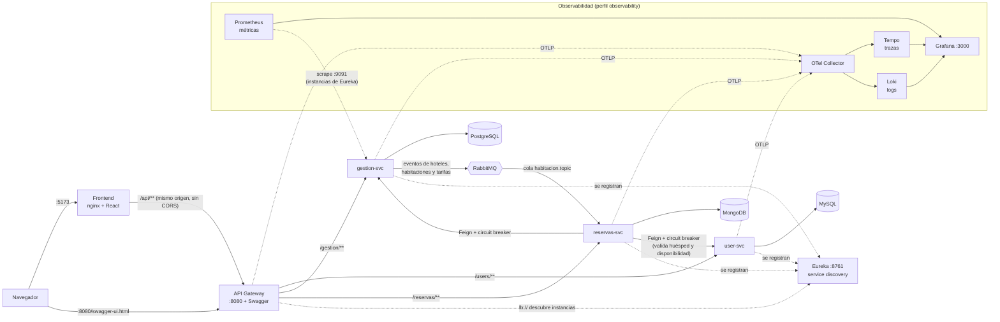

# Reservas ARN — TP Final DAN 2025

Sistema de **reserva de hoteles** hecho con microservicios (Spring Boot, Java 21), mensajería asíncrona (RabbitMQ), service discovery (Eureka), API Gateway, observabilidad (OpenTelemetry + Prometheus + Loki + Tempo + Grafana) y un frontend React. Se levanta completo con **un solo comando** y solo necesita Docker.

> TP de *Desarrollo de Aplicaciones en la Nube* — UTN FRSF. Integrantes: Arrua Alejandro, Nicle Santiago, Ramella Sebastian.

## Qué hace el sistema

Un **huésped** busca habitaciones por fechas, cantidad de personas, precio, estrellas, amenities y cercanía a una ciudad; ve el detalle (hotel, amenities, tipo, capacidad, tarifa vigente y total estimado), reserva, paga (total o parcialmente), cancela si todavía no pagó y deja su opinión después del check-out. Los **hoteles, habitaciones y tarifas** se gestionan en gestion-svc; cada cambio viaja por RabbitMQ a reservas-svc, que mantiene su propia réplica para buscar y reservar.

## Arquitectura



| Pieza | Rol |
|---|---|
| **frontend** | SPA React + Vite. En Docker la sirve nginx (sin root) y reenvía `/api/**` al gateway. |
| **gateway** | Único punto de entrada (`/users`, `/gestion`, `/reservas`), CORS y Swagger unificado. No expone el actuator. |
| **user-svc** | Huéspedes, propietarios, tarjetas, bancos y login (BCrypt). MySQL. |
| **gestion-svc** | Hoteles, habitaciones, tipos y tarifas. PostgreSQL. Publica eventos por RabbitMQ. |
| **reservas-svc** | Reservas, pagos, reviews y búsqueda (con índice geoespacial). MongoDB. Consume los eventos. |
| **Eureka** | Registro de instancias: permite escalar con `--scale` sin puertos fijos. |
| **RabbitMQ** | Mensajería asíncrona gestion-svc → reservas-svc. |

## Requisitos

- **Docker Desktop** (Windows/Mac) o Docker Engine + Compose v2.20+ (con BuildKit, activo por defecto).
- **~6 GB de RAM** asignados a Docker (la aplicación usa ≈ 3,5 GB; con observabilidad ≈ 5 GB).
- Puertos libres en el host: 5173, 8080, 8761, 15672 (y 3000, 9090 con observabilidad).
- No hace falta Java, Maven, Node ni ningún archivo `.env`: todo se compila dentro de Docker.

## Arranque en un comando

Desde la raíz del repositorio:

```bash
docker compose -f docker/docker-compose.yml up -d --build
```

(equivalente: `docker compose up -d --build`, el `docker-compose.yml` de la raíz solo hace `include` del de `docker/`).

- La **primera vez** compila los 5 servicios Java en una única etapa de Maven y construye el frontend: tarda **≈ 2–3 minutos** (medido: 2 min 16 s, con las imágenes base ya descargadas; la primera vez Docker además descarga las imágenes base, lo que depende de la conexión). Con la caché de Docker, reconstruir sin cambios tarda ~10 s y con un cambio de código ~50 s. Después los servicios tardan ~1 minuto más en estar *healthy*.
- Seguimiento: `docker compose -f docker/docker-compose.yml ps` (esperar que todos digan *healthy*) y `docker compose -f docker/docker-compose.yml logs -f gestion-svc`.
- Al arrancar se **cargan datos de demo automáticamente** (6 hoteles, habitaciones, tarifas y un usuario): ver más abajo.
- Para bajar todo: `docker compose -f docker/docker-compose.yml down` (agregar `-v` borra los datos; al volver a subir se recargan los de demo).

Extras opcionales por perfil (se pueden combinar):

| Perfil | Comando | Agrega |
|---|---|---|
| `observability` | `docker compose -f docker/docker-compose.yml --profile observability up -d` | OTel Collector, Tempo, Loki, Prometheus y Grafana |
| `tools` | `docker compose -f docker/docker-compose.yml --profile tools up -d` | pgAdmin, phpMyAdmin y Mongo Express |
| `dev` | `docker compose -f docker/docker-compose.yml --profile dev up -d frontend-dev` | Frontend con Vite en caliente (`http://localhost:5174`) |

## URLs y credenciales

| Qué | URL | Credenciales |
|---|---|---|
| **Frontend** | http://localhost:5173 | usuario demo: `demo` / `demo1234` (o registrarse) |
| **API Gateway** | http://localhost:8080 | — |
| **Swagger unificado** (3 servicios) | http://localhost:8080/swagger-ui.html | — |
| **Eureka** (instancias registradas) | http://localhost:8761 | — |
| **RabbitMQ** (consola) | http://localhost:15672 | `admin` / `admin` |
| Grafana *(observability)* | http://localhost:3000 | `admin` / `admin` |
| Prometheus *(observability)* | http://localhost:9090 | — |
| pgAdmin *(tools)* | http://localhost:6081 | `admin@admin.com` / `admin` |
| phpMyAdmin *(tools)* | http://localhost:6080 | acceso automático |
| Mongo Express *(tools)* | http://localhost:6091 | `admin` / `admin` |

Las bases de datos y el AMQP de RabbitMQ **no se publican** en el host (se usan desde la red de Docker; con `tools` hay interfaces web). Para conectarse con un cliente: [docs/desarrollo.md](docs/desarrollo.md#perfiles-de-docker-compose).

### Datos de demo

Se cargan solos si las bases están vacías (idempotente: reiniciar no duplica nada):

- **Usuario**: `demo` / `demo1234` (huésped con una tarjeta de crédito).
- **6 hoteles** ficticios en **Santa Fe, Rosario, Córdoba, Buenos Aires, Mendoza y Bariloche** (categorías 2 a 5), con amenities distintos, 4–6 habitaciones de distintos tipos (1 a 4 huéspedes) y tarifas vigentes. Las habitaciones llegan a reservas-svc por RabbitMQ, como cualquier alta.
- Desactivar: `DEMO_DATOS_HABILITADO=false docker compose -f docker/docker-compose.yml up -d`.

## Recorrido sugerido (10 minutos)

1. **Buscar y reservar (front)** — http://localhost:5173: en el buscador elegí *Santa Fe*, fechas futuras y 2 huéspedes → *Buscar*. Probá los filtros (precio, estrellas, amenities) y el orden. Abrí una habitación (se ve el precio por noche y el total estimado). Iniciá sesión con `demo` / `demo1234` y **Reservar**.
2. **Mis reservas** — pagá una parte (la reserva pasa de RESERVADA a CONFIRMADA); intentá **cancelar**: el backend responde 409 porque ya tiene un pago. El botón "Dejar opinión" se habilita recién desde el check-out (ver `APP_FECHA_ACTUAL` en [docs/desarrollo.md](docs/desarrollo.md#simular-la-fecha-de-hoy)).
3. **Eureka** — http://localhost:8761: user-svc, gestion-svc, reservas-svc y el gateway registrados.
4. **Escalar** — `docker compose -f docker/docker-compose.yml up -d --scale gestion-svc=3 --no-recreate` y llamá varias veces a http://localhost:8080/gestion/info: cambian `instancia` e `ip` (balanceo por Eureka). Volvé con `--scale gestion-svc=1`.
5. **Swagger y RabbitMQ** — http://localhost:8080/swagger-ui.html (elegí un servicio, *Try it out*). En http://localhost:15672 → *Queues* → `habitacion.topic`: creá una habitación desde Swagger de gestion-svc (`POST /gestion/habitaciones`) y mirá cómo aparece en `GET /reservas/habitaciones` unos instantes después.
6. **Trazas en Grafana** — `docker compose -f docker/docker-compose.yml --profile observability up -d`, reservá desde el front, y en http://localhost:3000 → *Explore* → **Tempo** → búsqueda por `service.name = gateway`: una única traza con el gateway, reservas-svc, las llamadas Feign a user-svc y gestion-svc y los comandos de MongoDB; desde un span, *Logs for this span* salta a los logs en Loki. El dashboard "DAN — Servicios" muestra métricas por servicio.
7. **Circuit breaker** — `docker compose -f docker/docker-compose.yml stop user-svc` y reservá (o `POST /reservas/reservas`): responde **503** con un mensaje claro (el front muestra "el servicio no está disponible") y el circuito se abre (panel *circuit breaker* del dashboard). `docker compose -f docker/docker-compose.yml start user-svc` lo recupera.

Una colección de Postman con todos los endpoints por el gateway está en [`docs/postman/`](docs/postman/DAN%20-%20API%20Gateway.postman_collection.json).

## Qué cubre cada etapa del enunciado

| Etapa | Qué se implementó | Dónde |
|---|---|---|
| **1 — user-svc** | Huéspedes y propietarios, tarjetas (una sola principal, no se borra la principal), bancos (CRUD), borrado en cascada de tarjetas, búsqueda por nombre/DNI, login con usuario/contraseña (BCrypt) y Google opcional. | `services/user-svc`, [ETAPA01.md](ETAPA01.md) |
| **2 — gestion-svc y reservas-svc** | Hoteles (alta validada, cierre, amenities), habitaciones, tipos y tarifas (reglas de vigencia y promociones); eventos por RabbitMQ; reservas con estados, pagos, reviews, disponibilidad y búsqueda geoespacial (MongoDB). | `services/gestion-svc`, `services/reservas-svc`, [ETAPA02.md](ETAPA02.md), [decisiones de diseño](docs/reservas-svc.md) |
| **3 — API Gateway** | Spring Cloud Gateway WebMVC con rutas por prefijo, CORS centralizado y Swagger unificado. | `common/dan-spring-gateway`, [ETAPA03.md](ETAPA03.md) |
| **4 — Eureka, Feign y escalado** | Service discovery, balanceo `lb://`, `--scale`, llamadas síncronas con OpenFeign, timeouts y circuit breaker (Resilience4j) con 503 claros. | `common/dan-eureka-server`, [ETAPA04.md](ETAPA04.md) |
| **5 — Observabilidad** | OpenTelemetry + Prometheus + Loki + Tempo + Grafana: métricas por servicio y réplica, logs con `trace_id`, trazas de punta a punta (HTTP, Feign, MongoDB y RabbitMQ), dashboard; actuator mínimo y no expuesto. | `docker/config/*`, [ETAPA05-OBSERVABILIDAD.md](ETAPA05-OBSERVABILIDAD.md) |
| **Extra — Frontend** | SPA conectada al backend (búsqueda, detalle, reserva, mis reservas, registro y login). | `frontend/` |
| **Entrega — Docker** | Compose en `docker/`, Dockerfiles multi-etapa sin dependencias locales, perfiles, datos de demo y CI. | `docker/` |

## Decisiones de diseño (resumen)

- **Base de datos por servicio** (MySQL, PostgreSQL, MongoDB) y comunicación asíncrona por eventos; reservas-svc mantiene una **réplica** de habitaciones solo por mensajes (consistencia eventual) y, al reservar, valida contra las fuentes de verdad por Feign. Detalle: [docs/reservas-svc.md](docs/reservas-svc.md).
- **Reserva concurrente sin transacciones**: `findAndModify` atómico sobre el documento de la habitación (nunca hay doble reserva).
- **Regla de pagos**: CONFIRMADA con al menos un pago (slide 14 del enunciado; el enunciado se contradice, ver el documento anterior).
- **Fallos remotos → 503, nunca 500**, con circuit breaker; los 404 de negocio no abren el circuito.
- **El gateway es el único punto de entrada**: CORS solo ahí, actuator en un puerto de gestión (9091) que no se publica ni se enruta.
- **Observabilidad desde el diseño**: Prometheus descubre las réplicas en Eureka; la traza viaja por `traceparent` (HTTP) y por headers del mensaje (RabbitMQ).
- **Docker**: un Dockerfile multi-etapa para todo el backend (el reactor se compila una sola vez, con caché de Maven), imágenes finales con JRE 21 y usuario no-root; nginx sin root para el front.
- Más detalle de cada etapa en [CLAUDE.md](CLAUDE.md) (guía técnica del repositorio).

## Limitaciones conocidas

- **Seguridad**: el login devuelve la identidad pero **no emite tokens (JWT)** y la API no verifica quién llama; cualquiera que llegue al gateway podría consultar o pagar reservas de otro `idHuesped`. Está documentado como mejora pendiente (JWT validado en el gateway + autorización por dueño): [CLAUDE.md](CLAUDE.md#seguridad-del-login-qué-hay-y-qué-falta).
- **Solo para demostración**: contraseñas de bases, RabbitMQ y Grafana por defecto (`admin/admin`), Eureka con *self-preservation* apagado, muestreo de trazas al 100 %, sin HTTPS.
- **JPA/JDBC no están instrumentados**: las trazas no muestran spans de SQL.
- **Tarea programada con réplicas**: con varias réplicas de gestion-svc, `TarifaPrecioScheduler` corre en cada una (el evento es idempotente; no hay lock distribuido).
- **Datos de demo**: si se borra solo MongoDB (no PostgreSQL), las habitaciones no se vuelven a replicar; usar `down -v`.
- **Los eventos que fallan en reservas-svc no se reintentan** (no hay cola de errores).
- **Memoria**: ≥ 6 GB para Docker; ≥ 7 GB con observabilidad y 3+ réplicas.

## Para desarrolladores

Cómo compilar y correr los tests, perfiles, publicar las bases en el host, simular la fecha, convenciones y estructura del repo: [docs/desarrollo.md](docs/desarrollo.md), [docs/estructura.md](docs/estructura.md) y [docs/ci.md](docs/ci.md). Guía técnica completa del repositorio: [CLAUDE.md](CLAUDE.md).
